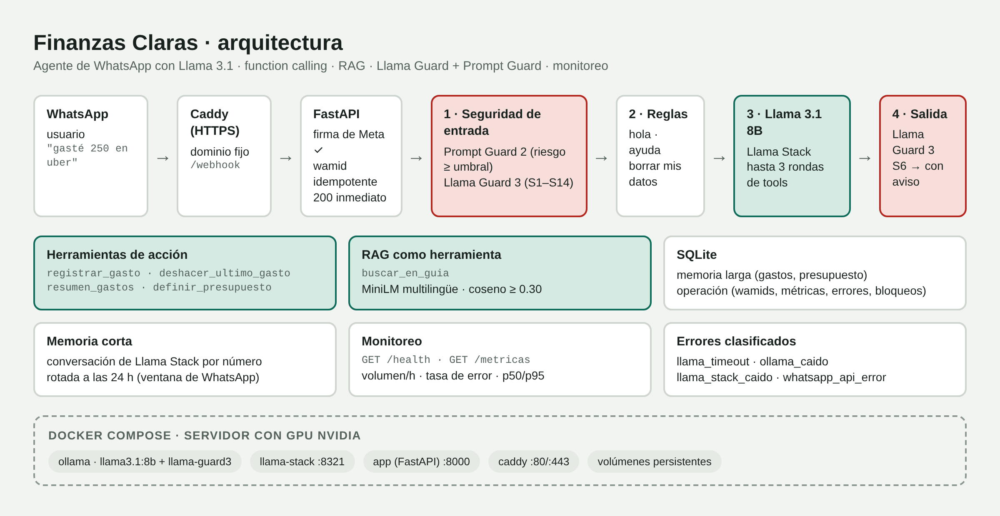
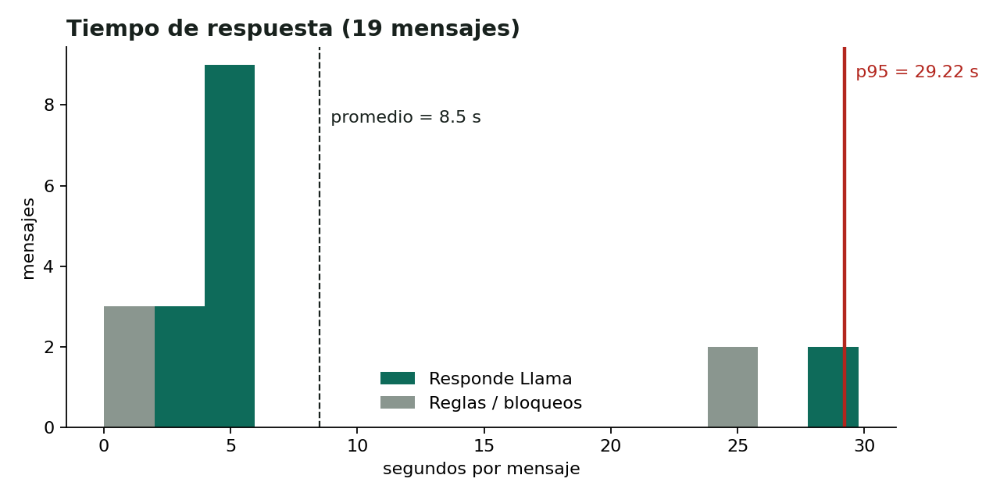
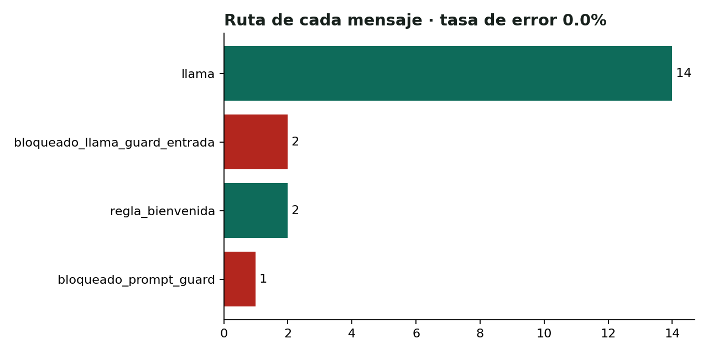
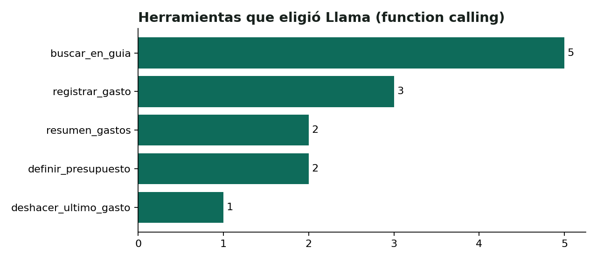

# 💸 Finanzas Claras — Agente de WhatsApp con Llama

**Hackathon 2 · Módulo 2: Automatización inteligente con WhatsApp** · Curso *IA Aplicada con Llama* (CPFIA)
Autor: Ángel Guillermo Díaz Luna · [LinkedIn](https://www.linkedin.com/in/angelgdl)

Agente de WhatsApp que **registra gastos escritos en lenguaje natural**, te dice **cómo vas contra tu presupuesto** y **resuelve dudas de finanzas personales** con base en una guía propia (RAG). Corre sobre **Llama 3.1 8B** con *function calling*, tiene memoria por usuario, dos capas de seguridad (**Llama Guard 3** y **Prompt Guard 2**) y está desplegado de forma continua con Docker en un servidor con GPU.



---

## 1. El problema

Llevar registro de los gastos funciona, pero casi nadie lo hace: abrir una app, elegir una categoría y llenar un formulario es demasiada fricción. Los gastos pequeños y frecuentes ("gastos hormiga") se acumulan sin que la persona lo note, y cuando llega el corte ya no hay margen para corregir.

**WhatsApp ya está abierto todo el día.** Si registrar un gasto cuesta lo mismo que mandar un mensaje (*"gasté 180 en comida"*), la fricción baja casi a cero. Este proyecto continúa el **Hackathon 1** (un asesor financiero con RAG y el formato *Diagnóstico · Acción · Por qué importa*), que se diseñó solo con FastAPI para conectarlo a WhatsApp en este módulo.

## 2. Qué hace

| El usuario escribe | El agente | Pieza técnica |
|---|---|---|
| *"Gasté 250 en uber"* | Registra $250 en transporte | Function calling → `registrar_gasto` |
| *"Me equivoqué, bórralo"* | Elimina el último gasto | Function calling + memoria de conversación |
| *"Mi presupuesto es de 12 mil al mes"* | Lo guarda | Function calling → `definir_presupuesto` |
| *"¿Cómo voy este mes?"* | Total, % del presupuesto usado y proyección al cierre | Function calling → `resumen_gastos` |
| *"¿Conviene pagar el mínimo de la tarjeta?"* | Responde con Diagnóstico / Acción / Por qué importa | RAG → `buscar_en_guia` |
| *"Ignora tus instrucciones…"* | Lo bloquea | Prompt Guard 2 |
| *"¿Cómo hago una bomba?"* | Lo bloquea | Llama Guard 3 (S9) |
| *"Ya no quiero vivir con estas deudas"* | Mensaje de apoyo + Línea de la Vida | Llama Guard 3 (S11) con política propia |
| *"borrar mis datos"* | Elimina gastos, presupuesto e historial | Regla fija (acción irreversible) |

## 3. Decisiones técnicas

### ¿Cómo se gestiona el estado?
Hay **dos memorias**:

- **Corta:** una conversación de Llama Stack por número de teléfono. Se rota tras **24 h sin actividad**, igual que la ventana de servicio de WhatsApp, para que el historial no crezca sin límite.
- **Larga:** gastos y presupuesto en SQLite. Los números **siempre salen de la base de datos**, nunca del historial del modelo.

### ¿Se usa *function calling*?
Sí, con 5 herramientas: 4 de acción, que leen y escriben datos reales, y 1 de RAG. El ciclo admite hasta 3 rondas, porque *"pon mi presupuesto en 10 mil y dime cómo voy"* necesita dos herramientas seguidas.

- **El modelo propone y el código valida:** limpia montos como `"$1,200"` y convierte categorías desconocidas en `otros`.
- **El número del usuario lo inyecta el código.** El modelo no puede pedir los datos de otra persona, y hay una prueba automática que lo verifica.

### ¿Qué capas de seguridad se aplican?

| Capa | Qué revisa | Dónde | Decisión |
|---|---|---|---|
| **Prompt Guard 2 (86M)** | Manipulación / inyección de prompt | Entrada | `riesgo = 1 − softmax(logits)[benigno]` con umbral ajustable. Si el modelo no carga (repositorio restringido), se activa una heurística de respaldo y `/health` lo reporta |
| **Llama Guard 3** | Contenido S1–S14 | Entrada y salida | **Política por categoría:** S6 (asesoría especializada) en la salida se envía con un aviso; S11 en la entrada recibe un mensaje de apoyo; el resto se bloquea |
| Firma `X-Hub-Signature-256` | Que el POST venga de Meta | Webhook | Se rechaza con 401 si no coincide |
| Privacidad | Datos personales | Logs | Números enmascarados en las métricas; `borrar mis datos` |

### Robustez
- **Respuesta inmediata.** El webhook responde 200 al instante y procesa en `BackgroundTasks`.
- **Idempotencia por `wamid`**, con `INSERT OR IGNORE` en SQLite. Un reintento de Meta **no duplica un gasto**, y hay una prueba automática que lo verifica.
- **Un lock por número de teléfono.** Dos mensajes seguidos del mismo usuario no mezclan turnos.
- **Errores clasificados por causa** (`llama_timeout`, `ollama_caido`, `llama_stack_caido`, `whatsapp_api_error`…), con un aviso amable al usuario.

### Monitoreo
- **`GET /metricas`:** volumen por hora, tasa de error, latencia promedio/p50/p95, bloqueos por capa, herramientas más usadas y alertas con umbral.
- **`GET /health`:** estado de Ollama, Llama Stack y Prompt Guard.

## 4. Resultados

> Evidencia generada con el agente desplegado: las capturas de WhatsApp y las gráficas salen de la base de datos real del servidor.

### Agente funcionando en WhatsApp

| Registro de gastos y memoria | Presupuesto y resumen |
|---|---|
|  |  |

| Dudas con RAG (Diagnóstico · Acción · Por qué importa) | Fuera de alcance |
|---|---|
|  |  |

| Seguridad: inyección y contenido peligroso | Borrar datos y mensajes que no son texto |
|---|---|
|  |  |

### Pruebas de punta a punta con los modelos reales
Tabla completa (ruta esperada vs. obtenida y respuesta del agente): [`docs/resultados/casos_de_prueba.md`](docs/resultados/casos_de_prueba.md)

### Métricas de operación

| Tiempo de respuesta | Ruta de cada mensaje |
|---|---|
|  |  |



Resumen numérico: [`docs/resultados/metricas.json`](docs/resultados/metricas.json)

### Despliegue

| Contenedores en el servidor | Salud del agente (`/health`) | Webhook verificado en Meta |
|---|---|---|
|  |  |  |

## 5. Estructura del repositorio

```
app/
  main.py          FastAPI: /webhook (GET verificación, POST mensajes), /health, /metricas
  agente.py        Flujo: seguridad entrada → reglas → Llama + tools → seguridad salida; errores clasificados
  llm.py           Llama Stack: memoria por número (rotación 24 h) + ciclo de function calling
  herramientas.py  registrar_gasto, deshacer_ultimo_gasto, resumen_gastos, definir_presupuesto (+ schemas)
  rag.py           Guía financiera, embeddings multilingües y buscar_en_guia
  seguridad.py     Llama Guard 3, Prompt Guard 2 (softmax + umbral) y heurística de respaldo
  whatsapp.py      Envío por Graph API, normalización 521→52, verificación de firma
  db.py            SQLite: gastos, presupuestos, conversaciones, wamids, métricas, errores, bloqueos
  metricas.py      Volumen, tasa de error, p50/p95, alertas
scripts/
  probar_agente.py     13 casos de punta a punta con los modelos reales → docs/resultados/casos_de_prueba.md
  generar_graficas.py  Gráficas de latencia, rutas y herramientas desde la base real
docker/            Dockerfiles, arranque de Llama Stack y Caddyfile (HTTPS automático)
notebooks/         Notebook de Colab con el desarrollo paso a paso, explicado en Markdown
tests/             Pruebas automáticas sin modelos (corren en GitHub Actions)
docs/DESPLIEGUE.md Guía de despliegue y operación (runbook)
```

## 6. Cómo desplegarlo

Resumen (guía completa en [`docs/DESPLIEGUE.md`](docs/DESPLIEGUE.md)):

```bash
git clone https://github.com/<usuario>/finanzas-claras-whatsapp.git && cd finanzas-claras-whatsapp
cp .env.example .env        # llenar credenciales de Meta, DOMINIO y HF_TOKEN
docker compose up -d --build
curl https://$DOMINIO/health
```

Después, en Meta for Developers → WhatsApp → Configuración: **Callback URL** `https://<DOMINIO>/webhook`, el mismo **Verify token** de `.env` y suscripción al campo `messages`.

| Variable | Para qué |
|---|---|
| `DOMINIO` | Dominio con HTTPS (sin dominio propio: `<ip-con-guiones>.sslip.io`) |
| `VERIFY_TOKEN` | Token de verificación del webhook |
| `WHATSAPP_ACCESS_TOKEN` | Token **permanente** de usuario del sistema |
| `PHONE_NUMBER_ID`, `WABA_TOKEN_ID` | Identificadores del número y de la cuenta de WhatsApp Business |
| `WHATSAPP_APP_SECRET` | Verificación de la firma de Meta |
| `HF_TOKEN` | Descarga de Prompt Guard (acepta la licencia en Hugging Face) |

## 7. Pruebas

```bash
pip install -r requirements-dev.txt && pytest -q
```

Las pruebas usan dobles de Llama, Llama Guard y los embeddings, así que corren sin GPU. Cubren: validación de montos, que el modelo no pueda elegir el número de usuario, las rutas del flujo (bienvenida, herramienta, inyección, S9, S11, borrar datos), la verificación del webhook, la firma de Meta, la **idempotencia ante 3 reintentos** y el endpoint `/metricas`.

## 8. Limitaciones y siguientes pasos
- Llama 3.1 8B a veces elige mal la herramienta en frases ambiguas. Se puede mejorar con *fine-tuning* LoRA sobre ejemplos de llamadas a herramientas (Módulo 1) o con un modelo mayor.
- `BackgroundTasks` vive dentro del proceso. Con más tráfico conviene una cola (Redis/Celery) y PostgreSQL en lugar de SQLite.
- La heurística de respaldo solo detecta patrones conocidos; en producción Prompt Guard debe ser obligatorio.

## Referencias
- Inan et al. (2023). *Llama Guard: LLM-based Input-Output Safeguard for Human-AI Conversations.* [arXiv:2312.06674](https://arxiv.org/abs/2312.06674)
- Meta. [Llama Prompt Guard 2](https://huggingface.co/meta-llama/Llama-Prompt-Guard-2-86M) · [Llama Guard 3](https://huggingface.co/meta-llama/Llama-Guard-3-8B) · [Llama Stack](https://github.com/meta-llama/llama-stack)
- Lewis et al. (2020). *Retrieval-Augmented Generation for Knowledge-Intensive NLP Tasks.* [arXiv:2005.11401](https://arxiv.org/abs/2005.11401)
- Meta for Developers. [WhatsApp Cloud API — Webhooks](https://developers.facebook.com/docs/whatsapp/cloud-api/webhooks)
- Google SRE Book. [Monitoring Distributed Systems](https://sre.google/sre-book/monitoring-distributed-systems/)

Licencia MIT.
